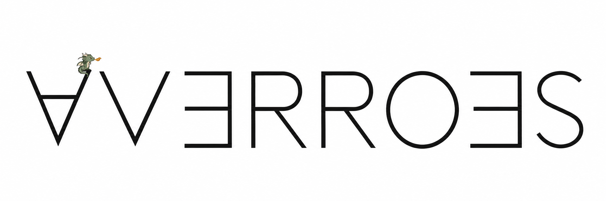

# Averroes

Averroes is a Lisp parser. The implementation and proofs are written in Lean. The proofs cover lexer and parser behavior and are available in [Averroes/Proof.lean](Averroes/Proof.lean).

[A Programmer's Mental Model for Proving](https://zenodo.org/records/24030830) presents an approach to formal verification based on exploring execution paths in a control-flow graph and modeling the corresponding proofs. Path conditions and properties of the input are formalized as hypotheses, from which the behavior of each return path is established.

## Name

The project is named after [Averroes](https://en.wikipedia.org/wiki/Averroes) (1126–1198), a philosopher, physician, and polymath whose work encompassed logic, medicine, astronomy, physics, and mathematics. His commentaries on Aristotle influenced later philosophical scholarship, while his medical compendium, *Colliget*, served as a textbook for centuries.
